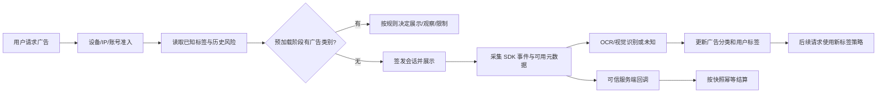

# 2026-10-11 广告内容识别与核减风险需求

## 1. 文档目的

本需求来自 `20261011需求.txt` 的聊天记录，目标是减少广告联盟最终结算核减，降低人工逐用户排查成本，并允许按广告内容标签和用户广告画像配置奖励。

需求包含两个相互独立的功能：

1. 自定义 ECPM 与释放比例。
2. 广告内容识别、异常用户画像、风险处置和差异化奖励。

自定义 ECPM 不参与核减判断，也不能被描述为核减预测模型的输入；聊天记录已明确两者是两个功能。

文档状态：待业务确认的需求草案。原文包含 4 个图片文件占位和 2 段语音占位，未包含图片内容或语音转写；本文件不推断缺失内容。下文建议值及技术方案不视为客户已确认参数。

## 2. 已确认的业务目标

- 平台在特定小时段出现核检或最终收益核减时，系统可以快速找到高风险用户和相关广告记录。
- 识别用户实际看到的广告内容，例如游戏、交友、金融理财、电商购物等。
- 按广告内容给广告会话打标签，汇总用户在统计周期内的广告类别占比。
- 当某类广告占比超过后台阈值时，给用户增加主标签，例如“金融理财偏好”或“电商购物偏好”。
- 对命中标签的后续广告请求实施配置好的奖励策略；奖励金额示例为 10 或 20 金币，但具体数值必须后台配置。
- 异常用户的明确处置方向为“不给请求、不给广告、不给展示”；判定依据尚未确定，允许暂缓实施。人工历史“不到账”的描述不等于已确认自动扣除已完成广告奖励。
- 低 ECPM 用户可以使用较高释放比例，高 ECPM 用户可以使用较低释放比例；此策略与核减判断独立。

## 3. 范围与边界

### 3.1 广告内容识别

识别结果分为三种来源，并必须保留来源：

| 来源 | 优先级 | 说明 |
|---|---:|---|
| 广告平台或聚合 SDK 元数据 | 最高 | 平台、广告源、素材 ID、应用名、行业字段等；字段必须经过真实样本验证 |
| OCR/图像或视频帧识别 | 次级 | 只能分析实际可合法获取的画面或文本；需获得必要系统授权并遵守平台条款 |
| 人工修正 | 最终覆盖 | 运营人员可以修改类别并记录原因，不能删除原始识别结果 |

当前 SDK 已知能返回平台、广告源、广告位、ECPM、展示形式、扩展字段等信息，但未确认统一的行业类别或推广应用名称字段。因此不能把平台名称直接当成广告行业，也不能假设截图中的应用名一定由 SDK 返回。

### 3.2 核减判断

系统不得声称可以直接推断联盟内部核减原因。结果必须分级：

- 平台确认：有平台账单、核减通知或原因码。
- 本地确认：系统日志能够证明重复回调、无效会话、验签失败等。
- 疑似相关：用户行为异常与核减时段相关，但没有平台归因。
- 无法判断：缺少平台证据或样本不足。

广告内容标签只能作为风险线索。金融、电商等标签本身不是作弊证据，不能单独证明用户异常。

### 3.3 奖励和处置

处置必须分开配置：

- `ALLOW`：正常展示和结算。
- `OBSERVE`：正常结算，只记录标签和证据。
- `LOW_REWARD`：按标签发放配置金币或释放比例。
- `BLOCK_AD`：请求阶段不签发广告会话。
- `REVIEW`：进入人工复核队列。

已完成且通过可信服务端回调的广告，默认不能因为事后 OCR 结果改变历史结算；如运营选择暂缓结算，必须在广告会话签发前明确状态。

以上状态是建议设计。`NO_REWARD`（已展示不发奖）不属于本期已确认范围；暂缓结算也尚未获业务确认，不应默认实现。分类与奖励的对象仍需明确：按本次广告类别发固定金币，还是按用户主标签影响之后所有广告。

## 4. 类别字典

初始类别建议固定为：

- `game` 游戏
- `social` 交友/社交
- `finance` 金融理财
- `ecommerce` 电商购物
- `education` 教育
- `tools` 工具/应用
- `content` 内容/短视频
- `other` 其他
- `unknown` 未知

类别字典由后台维护，但历史记录必须保存当时的类别名称和版本，不能因改名改变历史报表。

## 5. 广告会话数据模型

现有广告会话和事件记录继续作为主链路，新增以下信息：

### 5.1 广告识别记录

- `ad_session_id`
- `event_id`、请求/展示/点击/关闭/奖励时间
- `provider`、`network_name`、`adsource_id`、`placement_id`
- `show_id`、`request_id`、素材 ID（如平台提供）
- `advertiser_name`、推广应用名、包名（如平台提供）
- `format`、原始 ECPM、归一化 ECPM、币种
- `category`、`category_confidence`
- `source`: `sdk_metadata` / `ocr` / `ai_vision` / `manual`
- `model_version`、识别证据摘要、原始字段哈希
- `review_state`、人工修正人、修正时间和原因

原始截图或视频不默认长期保存；如业务必须保留，应经过单独的隐私和平台授权评审，并限制访问与保存期限。

### 5.2 用户标签记录

- `member_id`、`game_id`
- `tag_code`、展示名称
- 统计窗口：自然日、滚动 24 小时或最近 N 次广告
- 分母：有效展示会话数
- 分子：该类别的有效展示会话数
- 占比、最小样本数、阈值、标签状态
- `rule_version`、开始和结束时间

只有达到最小样本数且占比超过阈值，才能生成主标签；样本不足显示“数据不足”，不能生成风险标签。

## 6. 标签规则配置

后台按游戏配置：

- 每个类别的启用状态。
- 统计窗口：最近 N 次、滚动小时、自然日。
- 最小有效广告数，建议默认不少于 10 次。
- 主标签阈值，例如金融类占比超过 50%。
- 置信度下限，例如 AI 识别低于 0.85 记为未知或进入复核。
- 未知类别处理方式：忽略、计入分母、人工复核。
- 命中标签后的奖励金额或奖励比例。
- 是否仅观察、低奖励、暂停奖励、拒绝广告或人工复核。
- 标签过期时间和重新计算周期。

推荐默认规则：低置信度不进入类别分子；未知类别计入总展示数；样本不足不处置；先观察再启用自动限制。

## 7. ECPM 和释放规则

这部分与广告内容风控独立。

### 7.1 ECPM 定义

必须在后台显示单位和口径：

- `source_ecpm`：广告联盟返回的原始值。
- `normalized_ecpm`：按平台约定换算为元/千次后的值。
- `currency`：币种。
- `conversion_rule_version`：换算规则版本。

当前项目奖励计算使用归一化的人民币 ECPM。后台自定义 ECPM 应明确是归一化值，单位为“元/千次”，不能把原始接口整数直接当成元。

### 7.2 释放比例

保留现有五类平台比例：快手、优量汇、穿山甲、百度、其他，范围 0–1。原文已明确需要“低 ECPM 高释放，高 ECPM 低释放”，因此本次必须新增 ECPM 分段规则；仅有当前固定 ECPM 功能不能视为完成新增需求。以下仅为演示值，不是上线默认参数：

| ECPM 区间 | 释放比例 |
|---|---:|
| 0–50 | 1.00 |
| 50–100 | 0.80 |
| 100 以上 | 0.50 |

区间不能重叠，边界必须唯一；规则在广告申请时快照。

**后续截图补充（优先于上述演示数值）：**

后台采用两行逗号分隔输入：`50,100,200,300,500,1000,2000,3000,4000` 与 `200,70,70,70,65,60,50,40,30`，阈值和百分比逐项对应。200 为 200%，即 2 倍；本功能的分段比例不得复用现有 network_rates 的 0–1 上限。对外输入百分数，内部统一除以 100；设置单独的可控最大倍率。数量一致、阈值严格递增、非负、有限数值和无空项均需校验，并提供区间预览及试算。这里的 ECPM 是阈值，不是改写真实平台 ECPM。截图未证明阈值上下界语义、超过最高阈值行为或与平台比例相乘的口径，下一段区间设计仍为建议，不能当作已确认规则。

建议使用左闭右开区间 `[0,50)`、`[50,100)`、`[100,+∞)`。分段依据建议为本次可信、归一化人民币 ECPM；是否改为用户近期平均 ECPM 待确认。原文“10万比1”等换算描述是聊天参与者的解释，不可直接写死为全部平台统一换算系数；应按平台字段契约核验。

规则优先级建议：请求阻断优先；未阻断时，已命中的固定金币规则覆盖比例公式；否则使用 ECPM 分段比例，再使用原有平台比例作为未匹配分段的回退。分段比例与平台比例是否相乘、固定金币是否叠加白名单倍率、同时命中多个标签如何选择，均待确认。开发前应固定这组口径，避免叠加造成奖励偏差。

## 8. 处理流程

“直接不回调”不是可靠的业务动作。平台回调应正常接收、验签和记录；是否有效、是否结算由服务端状态决定。无效回调要返回明确错误并避免重复记账。

## 9. AI/OCR 实施方案

分三期：

1. **观察期**：只采集 SDK 元数据和允许的素材字段；OCR/视觉只输出类别、置信度和证据，不影响奖励。
2. **校准期**：运营人工复核样本，统计每个类别的精确率、未知率和平台差异；确定最小样本数及阈值。
3. **策略期**：只对高置信度、满足样本量的标签执行低奖励或拒绝新广告请求；保留人工解除和审计。

Android 截图、视频抓帧和无障碍读取受到系统权限及广告平台条款限制，不能作为默认必然能力。优先使用平台元数据；无法合法获取素材时结果为未知。

## 10. 权限、隐私与审计

- 会员个人广告标签只对授权的超级管理员、风控角色开放。
- 运营人员查看识别证据、修改标签和调整规则必须写入审计日志。
- IP、设备标识、定位和截图属于敏感数据，日志脱敏，接口最小化返回。
- 用户可关闭定位/设备观测并删除观测数据；关闭后不影响账号正常的必要登录流程。
- AI 服务调用不得上传手机号、支付宝账号、完整设备标识或无关应用列表。

## 11. 验收标准

### 内容识别

- 能展示平台、广告源、广告位、ECPM、事件和已确认的素材/类别字段。
- 无类别字段时显示未知，不根据平台名称猜测行业。
- OCR/AI 结果包含来源、置信度、模型版本和证据摘要。
- 相同素材 ID重复出现时可复用结果，人工修正可追溯。

### 用户标签

- 样本少于最小值不生成标签。
- 达到阈值后生成标签，低于阈值或过期后解除。
- 金融/电商标签可以配置 10/20 金币等策略，但策略变更不改历史结算。
- 同一广告事件不会重复计入样本或奖励。

### 核减分析

- 能按小时、日期、应用、平台、广告位导入或查看预估与最终结算差额。
- 明确区分平台确认、本地确认、疑似相关和无法判断。
- 能从异常用户反查广告会话和设备/IP证据，但不能把相关性显示成平台原因。

### ECPM

- 原始 ECPM 和归一化 ECPM 分开显示，单位明确。
- 自定义归一化 ECPM能够影响新广告会话奖励。
- 平台释放比例按映射后的可信广告源执行，规则和比例在申请时快照。

## 12. 待确认事项

在开始自动处置前必须确认：

1. 各广告平台/TAKU 是否允许获取素材截图、标题、推广应用名和行业字段。
2. “金融/电商”是只减少奖励、完全不奖励、拒绝展示，还是人工复核。
3. 标签统计窗口、最小样本数、置信度下限和过期时间。
4. 低 ECPM 高释放、高 ECPM 低释放的具体分段和边界。
5. 平台核减账单是否提供小时级数据、原因码和请求/展示关联 ID。
6. OCR/AI 服务部署位置、数据保留时间、费用上限和人工复核角色。
7. 固定金币规则按“单次广告类别”还是“用户主标签”触发；何时生效，以及与分段比例、平台比例、白名单倍率、奖励上限的优先级。
8. 分段 ECPM 按本次广告还是用户统计值判断；币种及来源缺失时回退或拒绝结算的口径。

## 12.1 建议交付顺序

1. 优先交付 ECPM 分段释放：原文 16:10 明确“先做这个”。后台配置区间、预览计算结果，服务端快照并测试区间边界、重复回调和配置切换。
2. 验证真实 SDK 元数据及素材获取能力，再实现广告名称/类别展示。18:02 已明确需要标签及固定金币能力，但技术可行路径仍需样本验证。
3. 上线观察型标签统计及人工修正，验收样本量、未知类别、比例边界和识别准确性。
4. 在奖励对象和优先级确认后上线固定金币策略；异步识别超时不得无限挂起结算。推荐新标签仅作用于后续签发会话。
5. 核减账单关联和自动异常用户拦截在取得平台证据、确定判断依据后实施；不能将金融占比超过 50% 的举例直接设为封禁规则。

## 13. 当前项目落差

当前代码已经支持自定义 ECPM、五类平台释放比例、广告会话规则快照、可信回调、会员档案和观察型设备风控；尚未完成广告行业识别、OCR/AI 结果表、用户类别标签、核减账单对账、ECPM 分段释放规则和自动处置策略。本需求文档不把这些未完成能力描述为已实现。
